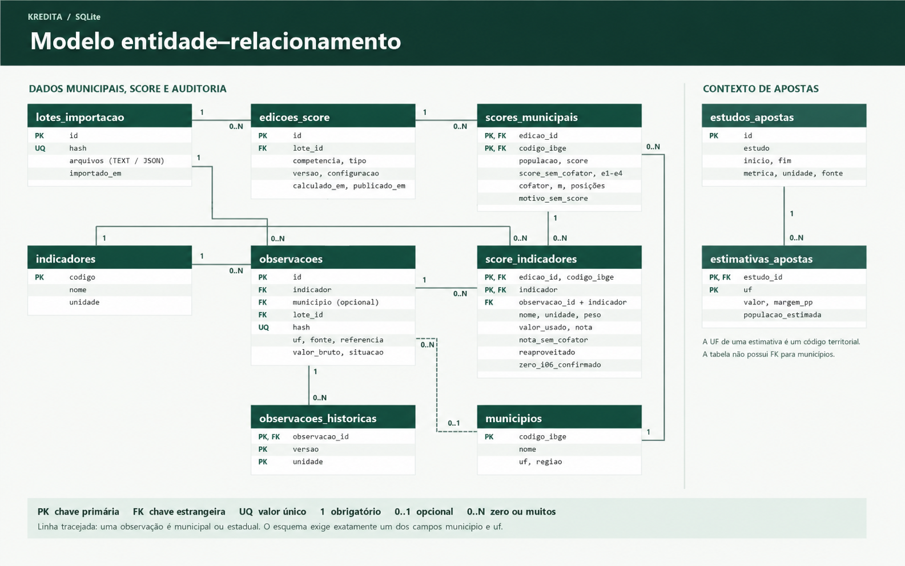

# Banco de dados do KREDITA

O banco de dados do KREDITA organiza os municípios, os indicadores, as informações coletadas e os resultados utilizados pela aplicação.

Além de permitir consultas para o ranking, os gráficos e as comparações, sua estrutura mantém a relação entre cada resultado e os dados utilizados no cálculo. Dessa forma, é possível consultar a origem das informações, identificar a edição do score e distinguir os valores brutos dos valores ajustados.

## Por que utilizamos SQLite?

O SQLite atende à arquitetura atual do projeto com uma estrutura simples de implantação e integração com Python.

Sua utilização permite:

- **Simplificar a configuração:** não exige a instalação de um serviço separado de banco de dados.
- **Integrar diretamente com o backend:** a aplicação utiliza o módulo `sqlite3` do Python.
- **Organizar dados relacionais:** oferece tabelas, chaves, relacionamentos, restrições e consultas SQL.
- **Preservar a consistência das importações:** as operações de publicação utilizam transações.
- **Facilitar a execução do projeto:** o banco pode ser criado pelo importador a partir dos arquivos disponibilizados.
- **Persistir os dados no ambiente Docker:** o arquivo do banco fica armazenado em um volume separado do container.

Essa escolha é compatível com uma aplicação voltada principalmente à consulta de dados, com atualizações realizadas pelo processo de importação.

O SQLite permite apenas uma escrita por vez. Caso o projeto passe a exigir muitas gravações simultâneas ou uma arquitetura distribuída entre vários servidores, a escolha do banco deverá ser reavaliada.

> A Oracle Cloud é a infraestrutura de hospedagem da aplicação. O banco utilizado pelo KREDITA é SQLite, não Oracle Database.

## Modelo entidade-relacionamento

O modelo está dividido em dois conjuntos:

- **Dados municipais, score e auditoria:** cadastros, observações, importações, edições e resultados.
- **Contexto de apostas:** estudos e estimativas apresentados como informação complementar.

### Legenda

| Símbolo | Significado |
| --- | --- |
| **PK** | Chave primária: identifica um registro. |
| **FK** | Chave estrangeira: relaciona registros entre tabelas. |
| **UQ** | Restrição de unicidade: impede valores duplicados no campo ou conjunto de campos. |
| **1** | Um registro relacionado. |
| **0..1** | Relacionamento opcional com até um registro. |
| **0..N** | Relacionamento com zero ou vários registros. |

## Estrutura das tabelas

### 1. `municipios`

Armazena a identificação territorial dos municípios.

| Campo | Finalidade |
| --- | --- |
| `codigo_ibge` | Chave primária com o código municipal de sete dígitos. |
| `nome` | Nome do município. |
| `uf` | Sigla da unidade federativa. |
| `regiao` | Região brasileira à qual o município pertence. |

O código IBGE conecta o município às observações municipais e aos resultados de cada edição.

A população é armazenada em `scores_municipais`, permitindo que seu valor acompanhe a edição dos dados.

### 2. `indicadores`

Mantém o cadastro dos indicadores utilizados na base.

| Campo | Finalidade |
| --- | --- |
| `codigo` | Chave primária do indicador, como `i01`. |
| `nome` | Nome do indicador. |
| `unidade` | Unidade de medida. |

Essa tabela padroniza a identificação dos indicadores nas observações e no detalhamento do score.

### 3. `lotes_importacao`

Identifica cada conjunto de arquivos importado.

| Campo | Finalidade |
| --- | --- |
| `id` | Chave primária do lote. |
| `hash` | Identificador único calculado a partir dos arquivos da importação. |
| `arquivos` | Registro dos arquivos e seus hashes, armazenado como texto JSON. |
| `importado_em` | Data e horário do registro da importação. |

O lote permite rastrear quais arquivos deram origem às observações e às edições do score. Seu hash auxilia a evitar a duplicação de uma mesma importação.

### 4. `observacoes`

Armazena os valores de origem dos indicadores, antes dos ajustes utilizados no score.

| Campo | Finalidade |
| --- | --- |
| `id` | Chave primária da observação. |
| `indicador` | Referência ao cadastro de indicadores. |
| `municipio` | Código IBGE, quando a informação é municipal. |
| `uf` | Sigla da UF, quando a informação é estadual. |
| `fonte` | Origem da informação. |
| `referencia` | Período de referência do dado. |
| `valor_bruto` | Valor registrado antes do ajuste e da normalização. |
| `situacao` | Classificação: `observado`, `estimado` ou `ausente`. |
| `lote_id` | Lote responsável pela importação. |
| `hash` | Identificador único da observação. |

Cada observação deve informar **exatamente um nível territorial**: município ou UF.

Quando a situação é `ausente`, o valor bruto deve ser `NULL`. Dessa forma, a ausência de informação não é confundida com um valor igual a zero.

### 5. `edicoes_score`

Registra as edições dos resultados.

| Campo | Finalidade |
| --- | --- |
| `id` | Chave primária da edição. |
| `lote_id` | Referência ao lote de importação. |
| `competencia` | Competência mensal no formato `AAAA-MM-01`. |
| `calculado_em` | Data e horário do cálculo, quando informados. |
| `publicado_em` | Data e horário do registro da publicação. |
| `versao` | Versão registrada para os resultados. |
| `configuracao` | Configuração da edição, armazenada como texto JSON. |
| `tipo` | Identifica uma edição `publicado` ou `simulacao_scr`. |

A separação por tipo permite distinguir os resultados publicados das simulações históricas baseadas no SCR.

> A competência da edição não significa que todos os indicadores tenham sido coletados naquele mês. Cada observação mantém seu próprio período de referência.

### 6. `scores_municipais`

Armazena o resultado consolidado de cada município em cada edição.

| Campos | Finalidade |
| --- | --- |
| `edicao_id`, `codigo_ibge` | Chave primária composta: identifica o município dentro da edição. |
| `populacao` | População utilizada como referência na edição. |
| `score` | Pontuação geral. |
| `score_sem_cofator` | Pontuação geral sem o ajuste do cofator. |
| `e1`, `e2`, `e3`, `e4` | Pontuações dos quatro eixos. |
| `cofator` | Cofator de reajuste utilizado. |
| `m` | Média municipal utilizada na composição do cofator. |
| `pos_brasil`, `pos_uf`, `pos_regiao` | Posições do município nos respectivos rankings. |
| `motivo_sem_score` | Justificativa registrada quando não há pontuação. |

Um município pode aparecer em várias edições, mas possui apenas um registro por edição.

A população é informação contextual: sua presença nessa tabela não significa que tenha peso no score.

### 7. `score_indicadores`

Detalha a participação de cada indicador no resultado municipal.

| Campos | Finalidade |
| --- | --- |
| `edicao_id`, `codigo_ibge`, `indicador` | Chave primária composta do detalhamento. |
| `observacao_id` | Referência à observação utilizada. |
| `nome`, `unidade` | Identificação do indicador registrada no detalhamento. |
| `valor_usado` | Valor efetivamente utilizado no cálculo, incluindo o ajuste quando aplicável. |
| `nota` | Nota normalizada do indicador. |
| `nota_sem_cofator` | Nota calculada sem o ajuste do cofator. |
| `peso` | Peso registrado para o indicador. |
| `reaproveitado` | Sinaliza o reaproveitamento de uma observação. |
| `zero_i06_confirmado` | Registra a confirmação de um valor zero do I06. |

Essa tabela conecta a pontuação à informação de origem.

Para um indicador estadual ajustado, por exemplo:

- `observacoes.valor_bruto` preserva o dado estadual;
- `score_indicadores.valor_usado` registra o valor utilizado após o ajuste;
- `score_indicadores.nota` registra a nota normalizada.

Assim, o ajuste não substitui nem transforma o dado estadual original em uma observação municipal.

### 8. `observacoes_historicas`

Relaciona observações à versão e à unidade utilizadas no registro histórico.

| Campo | Finalidade |
| --- | --- |
| `observacao_id` | Referência à observação. |
| `versao` | Versão associada ao registro. |
| `unidade` | Unidade de medida associada ao registro. |

Os três campos formam a chave primária composta.

Essa tabela apoia a identificação de observações históricas compatíveis com o processamento. O histórico das pontuações municipais é armazenado nas edições e nos respectivos scores.

### 9. `estudos_apostas`

Armazena a identificação dos estudos sobre apostas.

| Campo | Finalidade |
| --- | --- |
| `id` | Chave primária do estudo. |
| `estudo` | Nome ou descrição do estudo. |
| `inicio`, `fim` | Período abrangido. |
| `metrica` | Medida analisada. |
| `unidade` | Unidade de apresentação. |
| `fonte` | Origem das informações. |

### 10. `estimativas_apostas`

Armazena as estimativas territoriais vinculadas aos estudos.

| Campo | Finalidade |
| --- | --- |
| `estudo_id`, `uf` | Chave primária composta: estudo e código territorial. |
| `valor` | Valor percentual da estimativa. |
| `margem_pp` | Margem registrada em pontos percentuais, quando disponível. |
| `populacao_estimada` | População estimada, quando disponível. |

O campo `uf` funciona como código territorial e não possui chave estrangeira para `municipios`.

As informações sobre apostas são apresentadas como contexto complementar e não participam do cálculo do score.

## Relacionamentos principais

| Relação | Interpretação |
| --- | --- |
| `lotes_importacao` → `observacoes` | Um lote pode originar várias observações. |
| `lotes_importacao` → `edicoes_score` | Um lote pode originar várias edições. |
| `indicadores` → `observacoes` | Um indicador pode possuir observações de diferentes localidades e períodos. |
| `municipios` → `observacoes` | Um município pode possuir várias observações municipais. Observações estaduais não preenchem essa relação. |
| `edicoes_score` → `scores_municipais` | Uma edição pode conter resultados de vários municípios. |
| `municipios` → `scores_municipais` | Um município pode possuir resultados em várias edições. |
| `scores_municipais` → `score_indicadores` | Um resultado municipal pode possuir vários indicadores detalhados. |
| `indicadores` → `score_indicadores` | Um indicador pode participar de vários resultados. |
| `observacoes` → `score_indicadores` | Uma observação pode ser utilizada em vários resultados. |
| `observacoes` → `observacoes_historicas` | Uma observação pode possuir registros associados a versões e unidades. |
| `estudos_apostas` → `estimativas_apostas` | Um estudo pode apresentar estimativas para diferentes recortes territoriais. |

## Como as tabelas são criadas

A definição do banco está no arquivo:

[`backend/banco_de_dados/001_sqlite.sql`](../../backend/banco_de_dados/001_sqlite.sql)

O importador executa esse arquivo pela função `preparar_banco`, criando as tabelas, os índices e os gatilhos de validação.

As instruções utilizam `IF NOT EXISTS`, permitindo executar a preparação novamente sem recriar os objetos que já existem.

> Essa preparação não altera automaticamente a estrutura de uma tabela existente. Mudanças futuras no esquema precisam de uma atualização específica.

Depois da preparação, o processo de importação registra os cadastros, o lote, as observações e os resultados. A publicação utiliza transações: se ocorrer uma falha durante a operação, as alterações daquela transação são desfeitas.

No ambiente Docker, o banco fica em `/app/data/kredita.db`, dentro do volume persistente `data`.

## Regras de integridade

O esquema utiliza chaves, restrições e gatilhos para verificar condições como:

- Código IBGE formado por sete dígitos.
- Indicadores identificados no formato `iNN`.
- Observação associada a município ou UF, nunca aos dois simultaneamente.
- Coerência entre situação `ausente` e valor bruto `NULL`.
- Notas e scores, quando preenchidos, entre 0 e 100.
- Cofator, quando preenchido, entre −0,20 e +0,20.
- Pesos entre 0 e 1.
- Ausência de posições no ranking quando o score é nulo.
- Competência da edição no formato mensal esperado.
- Correspondência entre o indicador detalhado e o indicador da observação utilizada.

Essas verificações protegem a estrutura dos dados, mas não substituem a validação das fontes e das fórmulas.

## Consultas e persistência

O banco possui índices específicos para apoiar:

- A seleção das edições publicadas.
- A consulta do histórico de um município.
- A recuperação do ranking de uma edição.

As conexões habilitam as chaves estrangeiras com `PRAGMA foreign_keys = ON` e utilizam o modo WAL.

O acesso ao banco ocorre pelo backend Flask. O navegador recebe as páginas e os dados disponibilizados pela aplicação, sem acessar diretamente o arquivo SQLite.

## Arquivos relacionados

- [Esquema SQL](../../backend/banco_de_dados/001_sqlite.sql)
- [Importador e publicação dos dados](../../backend/importar_kredita.py)
- [Aplicação e conexão com SQLite](../../backend/app.py)
- [Consultas utilizadas pelo site](../../backend/consultas.py)
- [Testes do banco e da integração](../../backend/tests/test_sqlite.py)
- [Guia de operação](../operacao.md)
- [Documentação oficial: aplicações adequadas para SQLite](https://www.sqlite.org/whentouse.html)