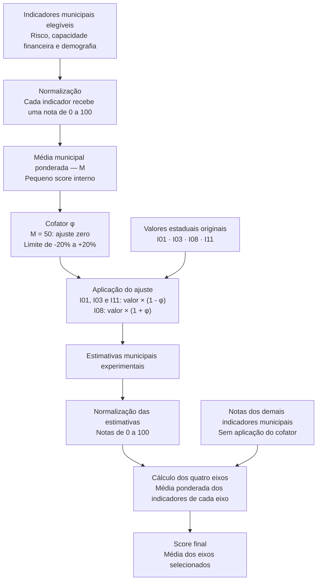

# Cofator de reajuste

## O que queremos alcançar com o cofator?

O objetivo do cofator é produzir uma **estimativa municipal experimental** para os indicadores I01, I03, I08 e I11, que, nas bases utilizadas pelo projeto, possuem recorte estadual.

Usar diretamente o valor da UF atribuiria a mesma informação a todos os seus municípios, sem considerar suas diferenças. **Um dado estadual não deve ser tratado como se tivesse sido medido no município.**

Para incorporar essas diferenças, o KREDITA utiliza indicadores municipais de risco, capacidade financeira e demografia. Esses indicadores formam uma **média municipal ponderada, chamada M**, que funciona como um pequeno score interno.

A partir dessa média, calculamos o **cofator de reajuste**, um percentual que pode aumentar ou reduzir o valor estadual em até 20%, conforme a orientação de cada indicador.

O caminho é:

**Dados municipais → média municipal M → cofator de reajuste → ajuste do valor estadual → estimativa municipal experimental.**

Dessa forma, dois municípios da mesma UF podem receber estimativas diferentes, mesmo partindo do mesmo valor estadual.

> **A intenção é aproximar o contexto estadual das características municipais. Essa aproximação é uma hipótese do modelo: as estimativas não substituem dados municipais observados e ainda precisam de validação para verificar se representam melhor a realidade local.**

### Como esse mecanismo funciona no cálculo?

A média municipal determina o sentido e a intensidade do ajuste:

- **Acima de 50:** o ajuste favorece as notas dos indicadores estaduais.
- **Igual a 50:** os valores estaduais permanecem iguais.
- **Abaixo de 50:** o ajuste desfavorece essas notas.

A alteração fica limitada a **20% do valor estadual original**, em cada direção.

Isso garante um comportamento matemático controlado. O ponto neutro, os pesos e o limite são escolhas da metodologia. A média M resume condições consideradas favoráveis pelo modelo, mas **não mede diretamente se um município é bom ou mau pagador**.

## Visão geral do cálculo



## 1. Quais indicadores determinam o ajuste?

As notas dos indicadores abaixo formam a média municipal **M**. Esses pesos são exclusivos do cálculo do cofator e não devem ser confundidos com os pesos do score final.

| Eixo de origem | Indicador municipal | Peso em M |
| --- | --- | ---: |
| Risco | I02 · Fragilidade de renda | 30% |
| Capacidade financeira e atividade | I04 · Desocupação | 10% |
| Capacidade financeira e atividade | I05 · Salário médio de admissão | 10% |
| Capacidade financeira e atividade | I06 · Saldo formal por mil habitantes | 10% |
| Capacidade financeira e atividade | I07 · Renda domiciliar per capita | 10% |
| Capacidade financeira e atividade | I09 · Valor Pix pago por PF por habitante | 10% |
| Demografia e infraestrutura | I13 · Variação populacional | 5% |
| Demografia e infraestrutura | I14 · Participação na força de trabalho de 18 a 64 anos | 5% |
| Demografia e infraestrutura | I16 · Agências por 100 mil habitantes | 10% |
| **Total** | | **100%** |

**Cálculo da média municipal:**

```text
M = 0,30 × N02
  + 0,10 × (N04 + N05 + N06 + N07 + N09)
  + 0,05 × (N13 + N14)
  + 0,10 × N16
```

**N** representa a nota normalizada do indicador. Por exemplo, **N02** é a nota do I02, não seu valor bruto.

A média M é uma etapa interna do cálculo, não um segundo score apresentado no ranking.

**O eixo Inclusão não participa da formação do cofator.** Os indicadores estaduais também ficam fora dessa média, evitando que o ajuste dependa dos próprios valores que irá modificar.

> A tabela representa a configuração completa. Quando um eixo participante é desativado, sua contribuição é retirada de M e os pesos dos grupos restantes são redistribuídos proporcionalmente. Desativar Inclusão não altera M, pois esse eixo já não participa do cofator.

## 2. Como essa média vira um cofator?

**Fórmula do cofator:**

```text
φ = clip(0,20 × ((M − 50) / 50); −0,20; +0,20)
```

| Termo | Significado |
| --- | --- |
| **M** | Média ponderada das notas municipais |
| **φ** | Cofator de reajuste |
| **50** | Ponto neutro definido para o modelo |
| **0,20** | Intensidade máxima do ajuste, equivalente a 20% |
| **clip** | Função que limita o resultado ao intervalo indicado |

Para calcular o cofator, subtraímos 50 da média municipal, dividimos por 50 e multiplicamos por 0,20.

| Média municipal M | Cofator φ | Efeito sobre as notas dos indicadores estaduais |
| ---: | ---: | --- |
| 0 | −20% | Ajuste máximo no sentido de reduzir as notas |
| 25 | −10% | Ajuste intermediário no sentido de reduzir as notas |
| 50 | 0% | Mantém os valores estaduais |
| 75 | +10% | Ajuste intermediário no sentido de elevar as notas |
| 100 | +20% | Ajuste máximo no sentido de elevar as notas |

> O limite de 20% incide sobre o **valor bruto estadual**. Ele não significa uma alteração de 20 pontos na nota ou no score final. Os limites da normalização também podem fazer com que uma alteração no valor bruto não modifique a nota.

## 3. Quais indicadores recebem o ajuste?

O ajuste acontece **antes da normalização**, produzindo as estimativas municipais experimentais.

| Indicador estadual | Cálculo da estimativa municipal | Quando φ é positivo |
| --- | --- | --- |
| I01 · Inadimplência PF | Valor estadual × (1 − φ) | O valor diminui |
| I03 · Composição dos saldos vencidos 90+ | Valor estadual × (1 − φ) | O valor diminui |
| I08 · Crédito/depósitos | Valor estadual × (1 + φ) | O valor aumenta |
| I11 · Crédito PF per capita | Valor estadual × (1 − φ) | O valor diminui |

Nas normalizações atuais, esses movimentos favorecem as notas dos quatro indicadores. Quando o cofator é negativo, o sentido se inverte.

No **I11**, a redução favorece a nota porque o modelo de inclusão atribui maior pontuação a menores valores de crédito per capita. Essa é uma convenção da metodologia, não uma previsão de queda do crédito.

### Exemplo: inadimplência estadual de 5%

Para um município com **M = 70**:

```text
φ = 0,20 × ((70 − 50) / 50)
φ = 0,08 = 8%
```

Aplicando o cofator ao I01:

**Estimativa municipal = 5% × (1 − 0,08) = 4,6%**

A redução foi de **8% sobre o valor original**, equivalente a **0,4 ponto percentual** na taxa.

A sequência é:

**Valor estadual de 5% → estimativa municipal de 4,6% → normalização → nota do I01 → composição do eixo Risco.**

O valor original de 5% continua sendo a referência observada. Os 4,6% representam somente a estimativa experimental produzida pelo modelo.