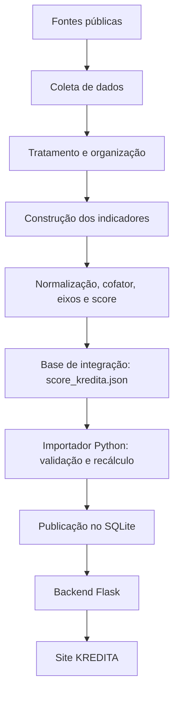
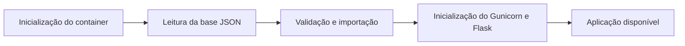
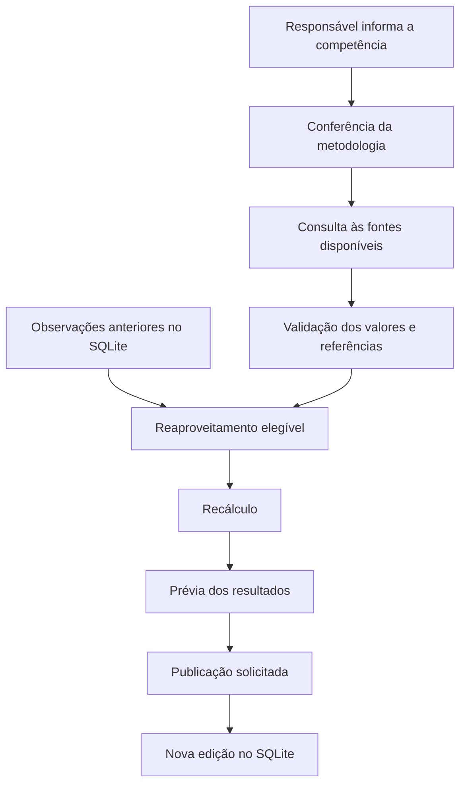
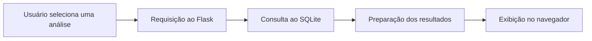

# Fluxo de dados do KREDITA

O KREDITA transforma dados públicos em informações para análise territorial. Esse processo envolve coleta, tratamento, construção dos indicadores, cálculo dos resultados, armazenamento e apresentação na aplicação.

O JSON utilizado pelo sistema não é a fonte original dos dados. Ele é um arquivo intermediário que reúne informações já organizadas e resultados preparados para integração.

Este documento distingue três momentos:

1. **Preparação da base:** transformação dos dados das fontes em indicadores e resultados.
2. **Carga e publicação:** validação da base e armazenamento no SQLite.
3. **Consulta e atualização:** apresentação dos resultados no site e processamento de novas informações.

O Google Colab foi utilizado no desenvolvimento do projeto. Na arquitetura atual, a execução da aplicação e as rotinas de atualização implementadas utilizam Python no backend, sem depender de um notebook em execução.

## 1. Visão geral

O caminho dos dados, desde sua origem até a consulta pelo usuário, é:

O diagrama apresenta as etapas de preparação e utilização da base. Ele não significa que todas sejam executadas automaticamente ao iniciar o site.

Na implementação atual, a aplicação já recebe o arquivo `score_kredita.json` no repositório. O importador utiliza esse arquivo para preparar a carga inicial.

As atualizações implementadas possuem outro caminho, apresentado adiante: consultam determinadas fontes e podem publicar novos resultados diretamente no banco.

## 2. Origem dos dados

Os valores utilizados nos indicadores têm origem em fontes públicas.

| Fonte | Informações utilizadas no projeto |
| --- | --- |
| **IBGE / SIDRA** | População, renda, trabalho e características demográficas. |
| **Banco Central — SCR.data** | Crédito e inadimplência em nível estadual. |
| **Banco Central — ESTBAN** | Saldos utilizados na relação entre crédito e depósitos. |
| **Banco Central — Pix** | Valores de pagamentos utilizados no indicador Pix por habitante. |
| **Banco Central — Informes de Agências** | Informações sobre agências bancárias. |
| **MTE — Novo CAGED** | Salários de admissão e movimentações do emprego formal. |
| **MDS — CadÚnico** | Informações sobre pessoas cadastradas. |

A coleta pode envolver APIs ou arquivos disponibilizados pelas instituições.

As fontes completas, unidades e definições de cada indicador estão no documento de [Indicadores](indicadores.md).

### Diferentes períodos e níveis geográficos

As informações não possuem necessariamente a mesma periodicidade ou abrangência.

Um dado pode ser:

- Municipal ou estadual.
- Mensal, anual ou censitário.
- Observado, estimado ou ausente.

Essas características precisam acompanhar a informação durante o processamento. A publicação de uma edição mensal não significa que todos os dados tenham sido coletados naquele mês.

## 3. Tratamento e organização

Os dados das fontes precisam ser organizados antes de serem utilizados nos cálculos.

Essa preparação envolve:

- Identificação dos municípios pelo código IBGE.
- Identificação das informações estaduais pela UF.
- Conversão dos valores para formatos numéricos.
- Seleção das categorias utilizadas por cada indicador.
- Agregação dos registros quando necessária.
- Compatibilização das unidades.
- Registro das fontes e dos períodos de referência.
- Identificação de valores ausentes.

### Identificação territorial

O código IBGE permite relacionar informações municipais de diferentes fontes e associá-las ao mapa.

Os dados estaduais permanecem identificados pela UF. Seu uso na análise municipal não altera a abrangência original da observação.

### Valores numéricos

A conversão deve respeitar o formato recebido.

Por exemplo, um texto com vírgula decimal exige tratamento diferente de um número que já foi convertido para formato numérico. Remover separadores indiscriminadamente pode alterar a ordem de grandeza dos valores.

### Ausência de informação

A ausência de um registro não deve ser interpretada automaticamente como zero.

Essa distinção é importante porque zero pode ser um resultado válido, enquanto ausência indica que a informação necessária não foi obtida.

## 4. Construção dos indicadores

Os registros coletados são transformados nos valores brutos dos indicadores.

O valor bruto já pode resultar de uma fórmula, como uma taxa ou uma razão. Ele recebe esse nome porque ainda não é a nota normalizada utilizada no score.

Exemplos:

| Informação preparada | Transformação |
| --- | --- |
| Valor de pagamentos Pix por pessoas físicas | Divisão pela população municipal. |
| Quantidade de pessoas no CadÚnico | Relação por 100 habitantes. |
| Quantidade de agências bancárias | Relação por 100 mil habitantes. |
| Saldos de crédito e depósitos | Construção da razão entre os saldos. |
| Valores da carteira de crédito | Construção dos indicadores de crédito e inadimplência. |

Os cálculos dependem das definições de cada indicador, incluindo numerador, denominador, unidade e abrangência territorial.

> Dividir um dado estadual por uma população não o transforma automaticamente em uma medição municipal. A origem territorial deve continuar identificada.

## 5. Cálculo das notas e do score

A metodologia transforma os valores brutos em notas comparáveis e combina essas notas nos quatro eixos do projeto.

O processamento inclui:

1. **Normalização inicial:** obtenção das notas necessárias à média municipal utilizada pelo cofator.
2. **Cálculo do cofator:** aplicação da configuração e dos pesos definidos para essa média.
3. **Ajuste estadual:** aplicação do cofator aos indicadores previstos na metodologia.
4. **Normalização dos valores utilizados:** conversão dos indicadores para a escala de notas.
5. **Composição dos eixos:** combinação das notas com seus respectivos pesos.
6. **Score geral:** combinação dos quatro eixos.
7. **Ranking:** ordenação dos municípios com resultado disponível.

A população absoluta permanece como informação contextual e não recebe peso no score.

O processamento também permite preservar:

- O resultado sem cofator.
- A média municipal utilizada no cofator.
- As notas dos indicadores.
- Os valores utilizados após o ajuste.
- A justificativa de indisponibilidade do score.

As fórmulas e os parâmetros estão nos documentos de [Score](score.md) e [Cofator](cofator.md).

## 6. Formação do arquivo JSON

Depois da preparação da base, os dados e resultados são organizados em um formato de integração.

No KREDITA, o arquivo utilizado é:

`backend/dados/score_kredita.json`

JSON é um formato de armazenamento de informações estruturadas. Ele não coleta dados nem executa cálculos: registra o conteúdo produzido pelo processamento.

### O que o arquivo reúne?

| Grupo | Conteúdo |
| --- | --- |
| **Versões** | Identificação do formato de integração e da base. |
| **Configuração** | Eixos, parâmetros e pesos utilizados. |
| **Indicadores** | Definições, unidades, fontes e referências. |
| **Municípios** | Identificação territorial e população. |
| **Valores brutos** | Valores utilizados como entrada dos cálculos. |
| **Resultados de referência** | Score, disponibilidade e posição nacional. |
| **Simulação SCR** | Competências e valores utilizados na série simulada. |

O arquivo permite transportar a base para a aplicação e conferir se o processamento do backend reproduz os resultados esperados.

### Origem da base inicial

A versão consultada do repositório inclui o JSON já preparado.

O arquivo registra a versão da base e suas referências, mas não identifica o programa que o gerou. A rotina responsável pela geração original não foi identificada entre os arquivos examinados da implementação atual.

Por esse motivo, a preparação da base é descrita aqui como uma etapa anterior à importação, sem atribuir sua geração a um notebook ou script específico.

Isso não impede a execução da aplicação: a base de integração necessária à carga inicial já acompanha o projeto.

## 7. Importação e conferência da base

O arquivo JSON é lido por:

[`backend/importar_kredita.py`](../../backend/importar_kredita.py)

A função `ler_exportacao` interpreta o pacote e organiza seus dados para validação e publicação.

O importador não confia apenas na pontuação pronta. A função `calcular` utiliza os valores brutos e a configuração recebida para recalcular os resultados.

### Verificações realizadas

Entre as verificações implementadas estão:

- Compatibilidade do formato de integração.
- Presença dos quatro eixos.
- Identificação dos indicadores esperados.
- Ausência de peso para a população absoluta.
- Códigos municipais válidos e sem duplicidade.
- Coerência entre disponibilidade e presença do score.
- Preenchimento de fontes e referências.
- Compatibilidade do score e da posição nacional com o recálculo.
- Cobertura dos municípios nas competências da simulação importada.

Uma incompatibilidade obrigatória interrompe a importação antes de sua conclusão.

> A conferência demonstra consistência entre a base e o processamento. Ela não substitui a validação das fontes ou a avaliação estatística da metodologia.

## 8. Publicação no SQLite

Após a validação, as informações são organizadas no banco relacional.

| Informação | Destino principal |
| --- | --- |
| Municípios | `municipios` |
| Cadastro dos indicadores | `indicadores` |
| Identificação da importação | `lotes_importacao` |
| Valores brutos, fontes e referências | `observacoes` |
| Competência, versão e tipo de resultado | `edicoes_score` |
| Scores, eixos, cofator e posições | `scores_municipais` |
| Valores utilizados e notas por indicador | `score_indicadores` |

A função `preparar_banco` executa o esquema SQL. A função `publicar` registra os resultados e suas relações.

As publicações utilizam transações. Caso ocorra uma falha durante a operação, as alterações daquela transação são desfeitas.

Os hashes identificam o conteúdo dos lotes e ajudam a evitar a repetição de uma mesma importação.

### Preservação da origem

O banco mantém separados:

- **Valor bruto:** informação de origem.
- **Valor utilizado:** valor aplicado ao cálculo, com ajuste quando previsto.
- **Nota:** resultado da normalização.

Assim, uma informação estadual ajustada continua rastreável até sua observação original.

A estrutura completa está no documento de [Banco de dados](banco_de_dados.md).

## 9. Inicialização da aplicação

Na configuração Docker do projeto, a inicialização executa o importador e, depois, inicia o Gunicorn para servir a aplicação Flask.

O fluxo é:

Essa inicialização utiliza a base fornecida com o projeto. Ela não executa uma nova coleta completa das fontes públicas.

O SQLite fica armazenado no volume persistente configurado para o Docker. O controle de lotes permite identificar conteúdo já publicado.

## 10. Atualização das fontes pelo backend

O importador também possui funções para buscar novas informações diretamente nas fontes públicas.

Esse caminho é separado da carga inicial e precisa ser acionado pelo responsável pela manutenção.

A rotina de atualização não precisa gerar um novo `score_kredita.json` para cada publicação. Ela utiliza a base de referência, organiza as novas observações e pode publicar os resultados diretamente no SQLite.

### Fontes contempladas nessa rotina

| Fonte | Indicadores relacionados |
| --- | --- |
| IBGE / SIDRA — estimativas populacionais | I13 e I15 |
| BCB — Pix | I09 |
| BCB — Informes de Agências | I16 |
| MDS — CadÚnico | I10 |
| BCB — SCR.data | I01, I03 e I11 |
| BCB — ESTBAN | I08 |

Essa cobertura não equivale à coleta automática de todos os indicadores.

Os indicadores censitários e os indicadores do CAGED não possuem uma nova coleta implementada nessa rotina específica. Sua manutenção depende da entrada de dados compatíveis ou das regras de reaproveitamento.

### Prévia e publicação

Os modos de atualização permitem consultar as fontes e avaliar os efeitos antes de gravar uma nova edição.

A prévia informa:

- Quantidade de observações atualizadas.
- Quantidade de observações reaproveitadas.
- Municípios que ganharam disponibilidade de score.
- Municípios que perderam disponibilidade de score.

A publicação depende da opção correspondente ou da confirmação no modo guiado.

Se nenhuma fonte retornar observações novas válidas para a competência solicitada, a atualização é interrompida.

## 11. Reaproveitamento e ausência de dados

Quando uma informação nova não está disponível, o processamento pode buscar uma observação anterior elegível.

A seleção considera a compatibilidade da informação, incluindo versão, unidade, fonte e período.

Para os indicadores classificados como mensais pelo importador, o reaproveitamento é limitado a até três competências anteriores. Essa janela não é aplicada da mesma forma aos indicadores não mensais.

O reaproveitamento:

- Mantém a referência original do dado.
- É identificado no detalhamento do resultado.
- Não significa que o dado foi coletado novamente.

Quando não existe informação válida nem observação elegível, o valor permanece ausente.

Na rotina de cálculo consolidado, a ausência de um indicador necessário impede a produção do score completo e gera uma justificativa. Não há substituição automática por zero ou nota neutra.

### Tratamento específico do I06

Um saldo formal igual a zero pode representar um resultado real ou um problema de disponibilidade dos registros.

No fluxo de importação com recálculo, o arquivo `caged_i06_zeros.csv` é utilizado para classificar esses casos. Essa identificação permite distinguir zeros confirmados de situações sem registro.

## 12. Histórico publicado e simulação SCR

O sistema distingue dois tipos de edição:

| Tipo | Interpretação |
| --- | --- |
| `publicado` | Resultado registrado como edição publicada da base. |
| `simulacao_scr` | Série simulada associada às variações do SCR. |

Na importação da simulação, os valores recebidos para risco e inclusão são combinados com os valores de capacidade e demografia da edição de referência.

Portanto, a série simulada não representa uma coleta mensal completa de todos os indicadores.

Na apresentação dos gráficos, é necessário distinguir:

- Mudanças entre edições publicadas.
- Variações da simulação SCR.

A simulação também não deve ser apresentada como previsão de resultados futuros.

## 13. Consulta e apresentação no site

Depois da publicação, o backend Flask consulta o SQLite e prepara as informações solicitadas pelo usuário.

O navegador não acessa diretamente o arquivo SQLite.

| Recurso | Informações utilizadas |
| --- | --- |
| **Visão geral** | Resumos e médias do recorte. |
| **Mapa** | Resultados associados aos códigos municipais e às geometrias. |
| **Ranking** | Scores e posições. |
| **Detalhamento municipal** | Eixos, indicadores, notas e cofator. |
| **Comparação** | Resultados das localidades selecionadas. |
| **Gráficos** | Edições publicadas e simulação SCR. |
| **Exportação** | Dados correspondentes à análise selecionada. |

### Dados geográficos do mapa

Os arquivos GeoJSON representam os limites territoriais dos estados e municípios.

As geometrias são associadas aos resultados pelos identificadores municipais. O arquivo do mapa define o território; a base da aplicação fornece sua pontuação.

### Filtros e seleção de eixos

Os filtros alteram o recorte apresentado. A seleção de eixos altera a composição da análise exibida conforme as regras da aplicação.

Essas interações não modificam os valores brutos das fontes nem publicam uma nova edição da base.

### Botão “Atualizar dados”

O botão solicita novamente o conteúdo da página ao backend.

Ele não inicia a coleta das fontes, não executa o Colab e não publica uma nova edição.

Para disponibilizar novos dados, é necessário concluir o processo de atualização e publicação.

## 14. Conteúdo contextual sobre apostas

As informações sobre apostas seguem um fluxo separado dos indicadores do score.

O arquivo `backend/dados/apostas.json` disponibiliza o conteúdo ao importador, que o organiza nas tabelas:

- `estudos_apostas`.
- `estimativas_apostas`.

A aplicação consulta essas informações para apresentar estudos, fontes, períodos e estimativas territoriais.

Esse conteúdo não participa do cálculo do score ou do cofator.

## 15. Documentos e arquivos relacionados

- [Indicadores e fontes](indicadores.md)
- [Metodologia do score](score.md)
- [Cofator de reajuste](cofator.md)
- [Banco de dados](banco_de_dados.md)
- [Base de integração](../../backend/dados/score_kredita.json)
- [Importador e processamento](../../backend/importar_kredita.py)
- [Esquema SQL](../../backend/banco_de_dados/001_sqlite.sql)
- [Backend Flask](../../backend/app.py)
- [Consultas da aplicação](../../backend/consultas.py)
- [Configuração Docker](../../Dockerfile)
- [Guia de operação](operacao.md)